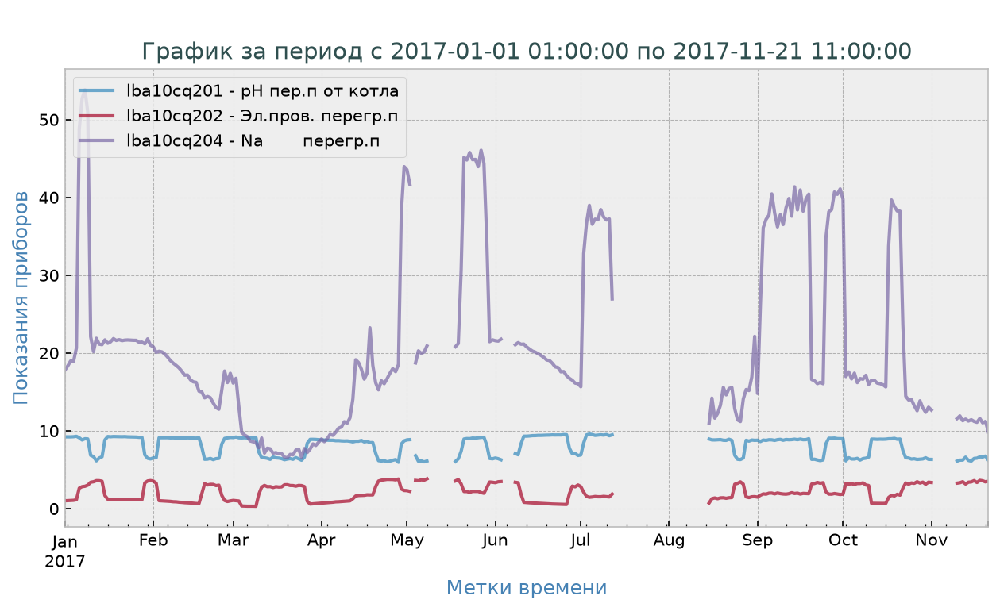
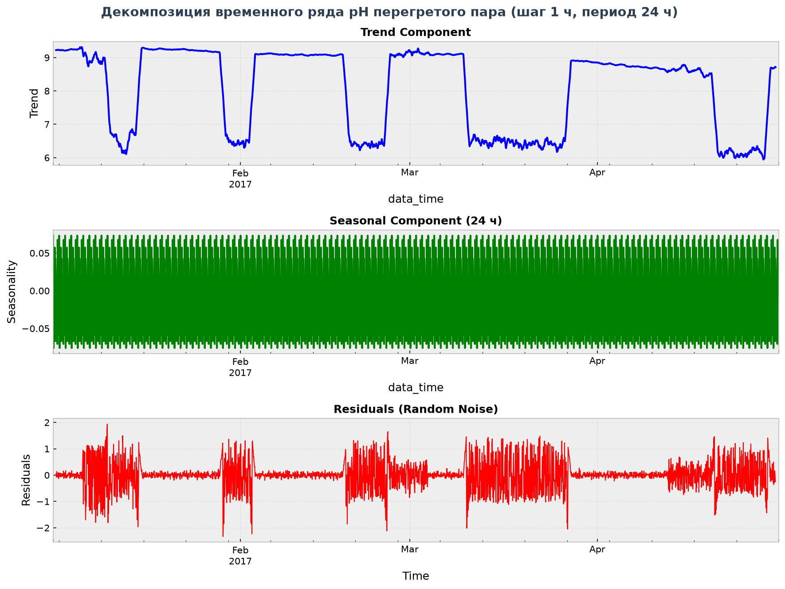
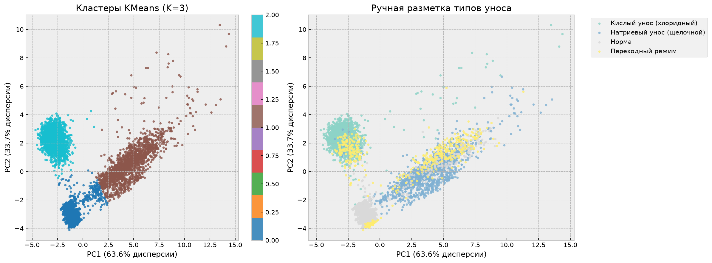
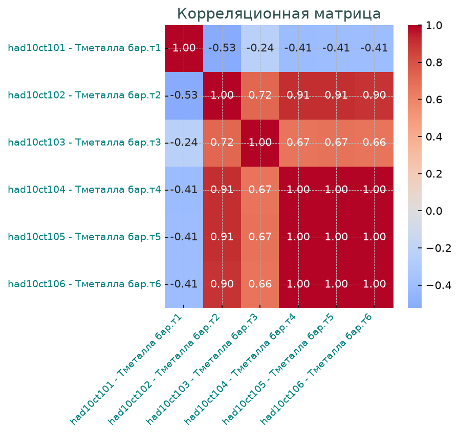
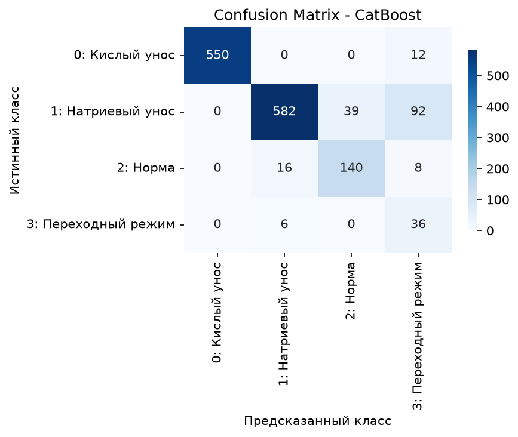
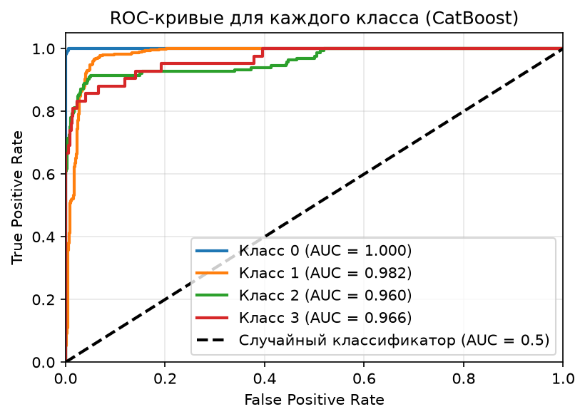

# Система раннего оповещения аварийных режимов водно-химического режима котла
## Описание проекта
Целью проекта является создание системы раннего оповещения о развитии аварийных режимов водно-химического режима (ВХР) котла. Система основана на анализе многомерных временных рядов данных SCADA-системы с дифференциацией типов уноса солей для выбора корректной корректирующей стратегии.


**Типы уноса (целевая переменная):**

*   `0`: Кислый унос (хлоридный)

*   `1`: Натриевый унос (щелочной)

*   `2`: Норма

*   `3`: Переходный режим

## Структура проекта

```text
.

├── data/                  # Исходные данные (таблицы)
├── reports/                
│    ├── figures/          # Графики
│    └── tables/           # Таблицы
├── notebooks/             # Jupyter Notebooks
│    ├── preparation.ipynb         
│    ├── markup_data.ipynb
│    ├── baseline_model.ipynb
│    └── final_model.ipynb
├── mypackage/             # Кастомная библиотека
├── requirements.txt       # Зависимости
└── README.md
```

### Описание ноутбуков:

preparation.ipynb — Загрузка, очистка и предобработка временных рядов. Обработка пропусков, выбросов, проверка стационарности, трендов и сезонности.

markup_data.ipynb — Разметка данных на основе комбинированных правил (экспертные + статистические), кластеризация (K-Means, PCA) и первичный анализ корреляций.

baseline_model.ipynb — Проверка наличия глобальной закономерности с помощью простых моделей (LogisticRegression, RandomForest) и наивного классификатора (Dummy). Разделение данных по сессиям (GroupKFold).

final_model.ipynb — Подбор гиперпараметров, обучение и сравнение ансамблевых моделей (RandomForest, XGBoost, CatBoost). Финальное тестирование лучшей модели.

### Данные:

columns.xlsx — таблица обозначений кодов параметров.

chemic.csv — сырые данные с приборов учета за 2017 год.

df_listparam.csv — преобразованная таблица обозначений кодов параметров.

df_restor.csv — данные после Data Preprocessing.

df_train.csv / df_test.csv — подготовленные датасеты для обучения и тестирования.

Важно: Данные содержат значительные временные разрывы (остановки котла), поэтому обучение и валидация проводились с группировкой по сессиям (отдельным эпизодам работы оборудования) с помощью StratifiedGroupKFold для предотвращения утечки данных (data leakage).

## Ключевые этапы и результаты

### 1. Предобработка и EDA

* Восстановление временных меток, замена недостоверных данных и удаление избыточных признаков. Анализ показал, что ряд не имеет монотонного тренда, а отражает разные режимы работы оборудования (режимное переключение со ступенчатой функцией).

* Остатки демонстрируют гетероскедастичность (разброс выше в режиме с низким средним).

* Тест на структурные сдвиги (PELT) подтвердил наличие режимов.


 


### 2. Разметка и кластеризация

* Применена rule-based разметка на основе абсолютных порогов (ПДК) и статистических порогов (Z-score > 2.5σ или > 3σ).

* Кластерный анализ (K-Means) выявил 3 естественных кластера, в то время как экспертная разметка выделяет 4. PCA-визуализация показала, что «Переходный режим» не имеет четких границ и смешивается с другими группами.

* Обнаружена сильная обратная корреляция между pH пара и электропроводностью пара (r = -0.76).

 

 

### 3. Бейзлайн (Baseline)

Сравнение простых моделей показало преимущество нелинейных алгоритмов:

* RandomForest: Accuracy=0.63, F1_macro=0.4653, ROC-AUC=0.9157.

* LogisticRegression: Accuracy=0.5659, F1_macro=0.3872, ROC-AUC=0.8874.

* DummyClassifier: Accuracy=0.2, ROC-AUC=0.5.

Наблюдение: Модель идеально детектирует класс «Кислотный унос» (AUC = 1.00) благодаря жесткой пороговой зависимости от pH. Главные признаки: lba10cq201 (pH), dow_sin, hour_sin.

### 4. Финальные модели

В качестве метрики выбрана F1-macro (для учета редких классов).

* Результаты CV: CatBoost (0.6404) > XGBoost (0.6290) > RandomForest (0.6254). Различия в пределах шума.

* На тестовой выборке CatBoost показал: F1_macro=0.767, F1_weighted=0.902, ROC-AUC_ovr=0.977.


[Топ важнейших признаков для CatBoost (таблица)](./reports/tables/top_features_CatBoost.csv)

 




## Ограничения и выводы

* Проблема данных, а не моделей: Хуже всего распознается «Переходный режим» (~49.9%). Это связано с физической близостью к соседним режимам, малым количеством данных (2.8% от выборки) и возможной несогласованностью rule-based разметки.

* Дискретность: Данные усреднены по часам, что размывает сигнал (процессы развиваются за минуты).

* CatBoost выбрана в качестве финальной, но улучшение придёт от данных и разметки, а не от алгоритма.

### Рекомендации:

1. Пересмотреть критерии разметки с экспертом-химиком (приоритет №1).

2. Уменьшить дискретность данных с 1 часа до 10–30 минут.

3. Собрать больше данных по переходным режимам.

4. Модель (CatBoost) практически пригодна для внедрения при условии, что редкий класс не является критичным, или после дообучения на исправленной разметке.

## Стек технологий

* Язык: Python 3
* Анализ данных: Pandas, NumPy
* Статистика: SciPy Stats, Statsmodels
* Машинное обучение: Scikit-learn, XGBoost, CatBoost
* Визуализация: Matplotlib, Seaborn, Ruptures, modulekrug (кастомная библиотека)
* Прочее: TQDM, Tabulate
* Среда разработки: Jupyter Notebook

## Как запустить
### 1. Клонировать репозиторий:
git clone https://github.com/your-username/your-repo.git
### 2. Создать и активировать виртуальное окружение (опционально, но рекомендуется):
* Windows: python -m venv venv -> venv\Scripts\activate
* Mac/Linux: python3 -m venv venv -> source venv/bin/activate
### 3. Установить зависимости:
pip install -r requirements.txt
### 4. Запустить Jupyter Notebook
jupyter notebook
### 5. Открыть нужный ноутбук из папки notebooks/ (начинать нужно с preparation.ipynb).

## Автор
*Ушакова Елена* ([GitHub](https://github.com/LoginaHelen), [Telegram](https://t.me/@LoginaHelen)) 