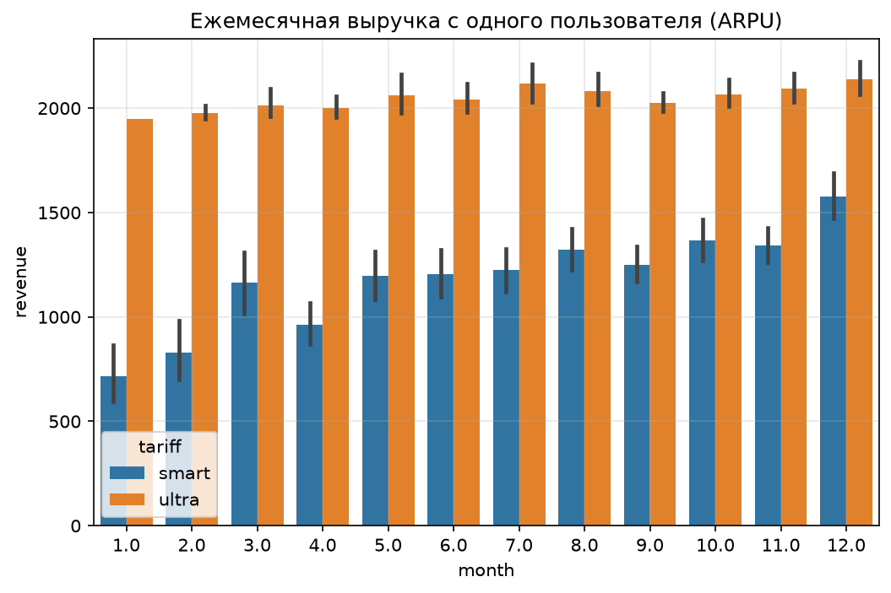
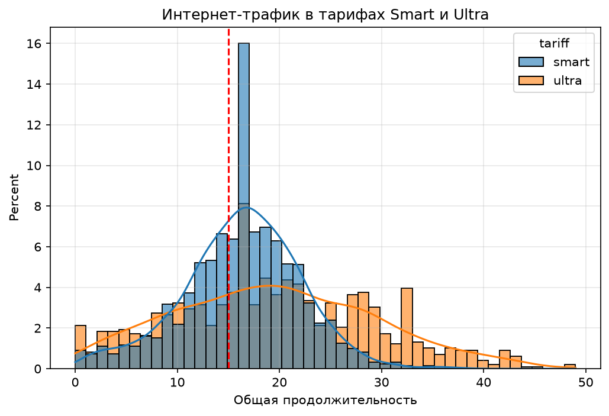
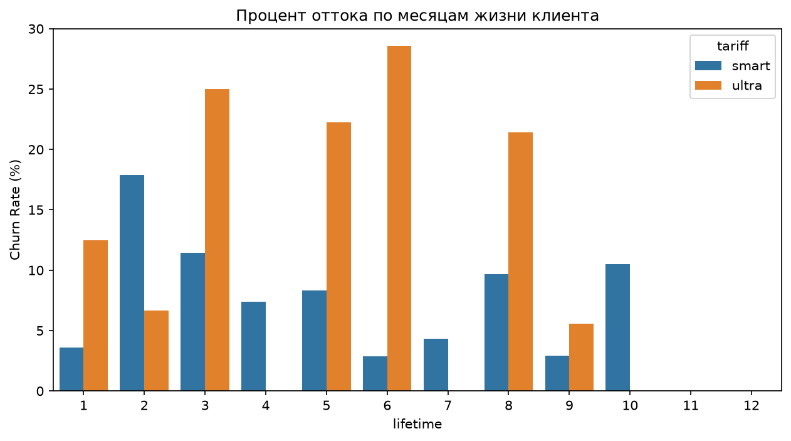
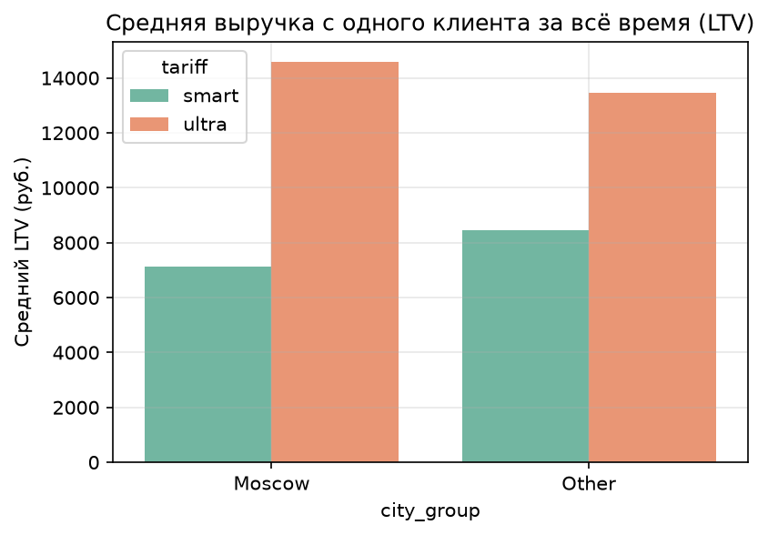

# Определение перспективного тарифа для телеком-компании

## Описание проекта

Клиентам оператора сотовой связи предлагают два тарифных плана: «Smart» и «Ultra». Коммерческому департаменту необходимо скорректировать рекламный бюджет и понять, какой тариф приносит больше денег.

В рамках проекта проанализировано поведение 500 пользователей за 2018 год (звонки, сообщения, интернет-трафик) и рассчитана выручка по каждому тарифу.

## Цели исследования

1. Описать поведение клиентов: звонки, сообщения, интернет-трафик.

2. Посчитать помесячную выручку и LTV с каждого пользователя.

3. Проверить гипотезы:

   * средняя выручка пользователей «Ultra» выше, чем у «Smart»;

   * средняя выручка пользователей из Москвы отличается от выручки из других регионов.

4. Сформулировать рекомендации для коммерческого департамента.

## Ключевые результаты

**1. Тариф «Ultra» монетизируется значительно лучше**

- Средняя выручка с пользователя (ARPU) «Ultra» статистически значимо выше.

- Несмотря на меньшее число клиентов (149 против 351), «Ultra» приносит в **1.6 раза больше выручки** за всё время (LTV 16 800 руб. против 10 200 руб.).

- «Ultra» лучше соответствует реальным потребностям: 30 ГБ покрывают большинство запросов, 3000 минут не исчерпываются почти никогда.



**2. Тариф «Smart» имеет структурные проблемы**

- **58.5%** пользователей не хватает 15 ГБ интернета (медиана потребления ~16 ГБ).

- **33.8%** превышают лимит в 500 минут, особенно в декабре.

- Постоянные доплаты за превышение пакетов формируют негативный пользовательский опыт (медиана доплат ~450-500 руб./мес).

- Наблюдается стабильный отток клиентов (пик на 2-м месяце жизни — 18%).




**3. Высокий отток «Ultra» сдерживает его прибыльность**

- «Ultra» теряет более 20% клиентов на 3-м, 5-м, 6-м и 8-м месяцах жизни. Пик потерь — 6-й месяц (28%).

- Это нивелирует приток новых клиентов, но LTV всё равно остается высоким.




**4. География не влияет на выручку**

- Пользователи из Москвы и других регионов приносят сопоставимую выручку (различия статистически незначимы).

## Рекомендации для коммерческого департамента

1. **Перераспределить рекламный бюджет:** увеличить инвестиции в привлечение «Ultra» (при условии, что CAC остается ниже LTV) и перенаправить часть бюджета на удержание клиентов «Ultra» на 4–6 месяце жизни, чтобы максимизировать LTV.

2. **Ввести «перенос остатков» (Roll-over) для Ultra:** если пользователь не истратил 20 ГБ в этом месяце, пусть перейдут на следующий. Это снимет боль от «сгоревших» денег.

3. **Сделать доплаты в Smart выгодными:** предлагать «Автопакет» дополнительных ГБ или минут по сниженной цене.

4. **Улучшить удержание клиентов:** внедрить уведомления о приближении к лимитам для снижения неожиданных переплат.



## Структура проекта

```text
.

├── data/                  # Исходные данные (calls, internet, messages, users, tariffs)
├── images/                # Графики
├── analysis.ipynb         # Основной ноутбук
├── requirements.txt       # Текстовый файл с зависимостями
└── README.md
```

## Технологии

* Data Analysis: Pandas, NumPy
* Statistics: SciPy Stats
* Data Visualization: Seaborn, Matplotlib
* Environment: Jupyter Notebook

## Как запустить
### 1. Клонировать репозиторий:
git clone https://github.com/your-username/your-repo.git
### 2. Создать и активировать виртуальное окружение (опционально, но рекомендуется):
* Windows: python -m venv venv -> venv\Scripts\activate
* Mac/Linux: python3 -m venv venv -> source venv/bin/activate
### 3. Установить зависимости:
pip install -r requirements.txt
### 4. Запустить Jupyter Notebook
jupyter notebook
### 5. Открыть ноутбук analysis.ipynb

## Автор
*Ушакова Елена* ([GitHub](https://github.com/LoginaHelen), [Telegram](https://t.me/@LoginaHelen)) 